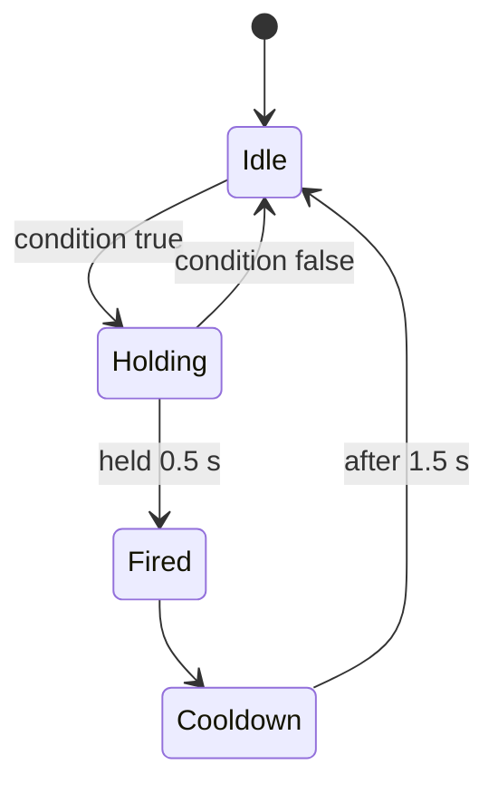

# CyberVision

**A sci-fi body scanner for your webcam.**

CyberVision runs four YOLOv8 models on your live camera image and turns the result into a neon HUD, a hologram, a see-through ghost and a time echo. Everything runs on your own computer.


## The four YOLO skills

| Skill | Model | Job in the app | How often |
|---|---|---|---|
| Pose + tracking | `yolov8n-pose` | Skeleton, stable person IDs, angles, posture, motion energy, gestures | every frame |
| Segmentation | `yolov8n-seg` | Exact person outline for the effects | every frame |
| Detection | `yolov8n` | Objects near the hands ("CARRY: cup") | every 2nd frame |
| Classification | `yolov8n-cls` | Scene label ("ENV: office 72%") | every 2 seconds |

## Modes

| Mode | What you see |
|---|---|
| HUD | Glowing outline, neon skeleton, a data panel for each person |
| HOLOGRAM | Cyan tint, scan lines, glitch bands |
| GHOST | You turn see-through over a background the app learns by itself |
| TIME ECHO | Fading copies of your last positions |

## Gestures

| Gesture | Action |
|---|---|
| Both wrists above the nose (hands up) | Next mode |
| T-pose (arms level with shoulders, wide apart) | Save a screenshot to `screenshots/` |

Each gesture needs a short hold, then pauses, so it never fires twice.

## How it works

```mermaid
flowchart LR
    CAM["Camera"] --> THR["Camera thread<br/>keeps newest frame"]
    THR --> ENG

    subgraph ENG["Engine"]
        direction TB
        POSE["Pose + tracking<br/>every frame"]
        SEG["Segmentation<br/>every frame"]
        DET["Detection<br/>every 2nd frame"]
        CLS["Classification<br/>every 2 s"]
    end

    ENG --> DATA

    subgraph DATA["Person data"]
        direction TB
        D1["id, box, keypoints, mask"]
        D2["angles, posture, energy"]
        D3["carrying"]
    end

    DATA --> FX

    subgraph FX["Effects"]
        direction TB
        E1["HUD"]
        E2["HOLOGRAM"]
        E3["GHOST"]
        E4["TIME ECHO"]
    end

    FX --> BR["Browser"]
    DATA --> GES["Gestures"]
    GES -->|"hands up: next mode"| MODE["Mode"]
    GES -->|"T-pose: screenshot"| SHOT["screenshots/"]
    MODE --> FX
```



Gesture timing (`GestureTrigger`):



## Function reference

Names starting with `_` are internal helpers. "Internal" is marked in the first column.

### `cybervision/engine.py`

| Name | Input | Output | What it does |
|---|---|---|---|
| `_iou` (internal) | two boxes `[x1, y1, x2, y2]` | float 0 to 1 | Overlap of two boxes (intersection over union). |
| `Engine` | none | engine object | Loads the four YOLO models and keeps per-session state (frame counter, tracker memory). |
| `Engine.__init__` | none | none | Picks `mps` or `cpu`, loads the models from `models/` or downloads them. |
| `load` (internal, inside `Engine.__init__`) | model name | YOLO model | Loads `models/<name>.pt` if present, else downloads it. |
| `Engine._timed` (internal) | key, function | the function's result | Runs a function and stores its time in ms under the key. |
| `Engine._pose` (internal) | frame, conf | list of person dicts | Pose model with tracking; returns id, box, keypoints, confidences. |
| `Engine._seg` (internal) | frame, conf | list of `(box, bool mask)` | Segmentation model; draws each outline polygon into a full-frame mask. |
| `Engine._detect` (internal) | frame, conf | list of `{name, box, conf}` | Object detection; skips the "person" class. |
| `Engine._classify` (internal) | frame | `(label, confidence)` | Scene classification; returns the top label and its score. |
| `Engine.process` | frame, settings dict (`conf`, `pose`, `seg`, `detect`, `cls`) | dict `people`, `objects`, `env`, `ms` | Runs the enabled models on schedule, matches masks to people, adds angles, posture, energy and carrying. |
| `Engine._carrying` (internal) | one person dict | list of object names | Objects whose centre is near a wrist (or inside the person box if no wrist is seen). |

### `cybervision/camera.py`

| Name | Input | Output | What it does |
|---|---|---|---|
| `Camera` | camera index (or a capture object, for tests) | camera object | Reads the camera in a background thread so the app never waits for a frame and never shows an old one. |
| `Camera.__init__` | source | none | Opens the camera and starts the reader thread. |
| `Camera.isOpened` | none | bool | Whether the camera opened. |
| `Camera._run` (internal) | none | none | Thread loop: read frames, keep only the newest and count them. |
| `Camera.read` | none | `(ok, frame, seq)` | Newest frame and its counter, without waiting; a new `seq` means a new frame. |
| `Camera.stop` | none | none | Stops the thread and releases the camera. |

### `cybervision/gestures.py`

| Name | Input | Output | What it does |
|---|---|---|---|
| `_pt` (internal) | kp, conf, index | point array or `None` | One keypoint, or `None` if missing, low confidence or invalid. |
| `_shoulder_width` (internal) | kp, conf | float or `None` | Distance between the shoulders; the unit for posture and energy. |
| `angle` | points a, b, c | degrees or `None` | Angle at point b between a and c. |
| `_angles` (internal) | kp, conf, list of index triples | tuple of angles | Angle for each triple of keypoints. |
| `elbow_angles` | kp, conf | `(left, right)` | Elbow angles in degrees; `None` where unknown. |
| `knee_angles` | kp, conf | `(left, right)` | Knee angles in degrees; `None` where unknown. |
| `posture_score` | kp, conf | int 0 to 100 | Higher for level shoulders and a centred head; 0 if unknown. |
| `motion_energy` | prev kp, prev conf, kp, conf | float | Mean keypoint movement between frames, in shoulder widths. |
| `is_hands_up` | kp, conf | bool | True when both wrists are above the nose. |
| `is_t_pose` | kp, conf | bool | True when both wrists are level with the shoulders and far apart. |
| `GestureTrigger` | `hold_s`, `cooldown_s`, `clock` | trigger object | Fires once after a gesture is held, then ignores input for a while. |
| `GestureTrigger.__init__` | `hold_s=0.5`, `cooldown_s=1.5`, `clock` | none | Sets hold time, cooldown time and the clock. |
| `GestureTrigger.update` | bool `active` | bool | Call once per frame; returns True on the frame the gesture fires. |

### `cybervision/effects.py`

| Name | Input | Output | What it does |
|---|---|---|---|
| `_ok` (internal) | frame | bool | Checks the frame is a non-empty colour image. |
| `_mask` (internal) | mask, shape | bool mask or `None` | Resizes a mask to the frame size; `None` if absent or empty. |
| `_union` (internal) | people, shape | bool mask | Combines the masks of all people. |
| `_clip_box` (internal) | box, shape | int box or `None` | Clips a box to the frame; `None` if nothing is inside. |
| `_skeleton` (internal) | image, kp, conf, color, thick | none (draws in place) | Draws bones and joints for confident keypoints. |
| `_text` (internal) | image, text, position, color, scale | none (draws in place) | Draws one line of HUD text. |
| `_bar` (internal) | image, x, y, width, fraction, color | none (draws in place) | Draws a small progress bar. |
| `_fmt` (internal) | number or `None` | string | Formats an angle, or `--` if unknown. |
| `_panel` (internal) | image, person, box | none (draws in place) | Draws the data panel (id, angles, posture, energy, carrying) above a person. |
| `draw_hud` | frame, people, mode, fps, env | image | Outline glow, skeletons, panels and the top status bar. |
| `hologram` | frame, people | image | Cyan tint, scan lines and glitch bands on the people. |
| `BackgroundModel` | `rate` | model object | Learns the empty background slowly over time. |
| `BackgroundModel.__init__` | `rate=0.05` | none | Sets the learning rate; no background yet. |
| `BackgroundModel.update` | frame, people | none | Blends pixels away from people into the background. |
| `BackgroundModel.ghost` | frame, people | image | Replaces people with the background at 75 percent, plus thin skeletons. |
| `TimeEcho` | `n`, `every` | effect object | Keeps recent silhouettes and draws them as fading echoes. |
| `TimeEcho.__init__` | `n=6`, `every=3` | none | Keeps up to `n` copies, one every `every` frames. |
| `TimeEcho.apply` | frame, people | image | Saves a copy now and then; draws older copies in magenta behind you. |

### `app.py`

| Name | Input | Output | What it does |
|---|---|---|---|
| `save_screenshot` | image | file name | Saves the image as PNG in `screenshots/` with a timestamp name. |
| `toggle` | none | none | Start/Stop button callback; flips `running`. |

The rest of `app.py` is the Streamlit page: sidebar controls, then the camera loop (newest frame from `Camera`, `Engine.process`, effect for the mode, show, check gestures).

## Install

```bash
python -m venv .venv && source .venv/bin/activate
pip install -r requirements.txt
```

Model weights download automatically on first run (or put them in `models/`).

## Run

```bash
streamlit run app.py
```

Press **Start** in the sidebar.

## Camera tips

- On macOS, allow camera access for your terminal in System Settings > Privacy & Security > Camera.
- If the picture stays black, try another **Camera index** in the sidebar. On Macs with an iPhone nearby, index 0 is often the iPhone.

## Privacy

The server binds to localhost only (`.streamlit/config.toml`). Camera frames never leave your computer. Screenshots are saved locally to `screenshots/`.

## Tests

```bash
pytest
```

## Project structure

```
app.py                   Streamlit UI and camera loop
cybervision/
  camera.py              background camera reader (newest frame only)
  engine.py              model loading and per-frame scheduling
  gestures.py            angles, posture, energy, gesture checks
  effects.py             HUD, hologram, ghost, time echo
tests/                   pytest
.streamlit/config.toml   localhost-only server settings
requirements.txt
```

## Built for a computer vision course

CyberVision was made as a project for a computer vision course.
